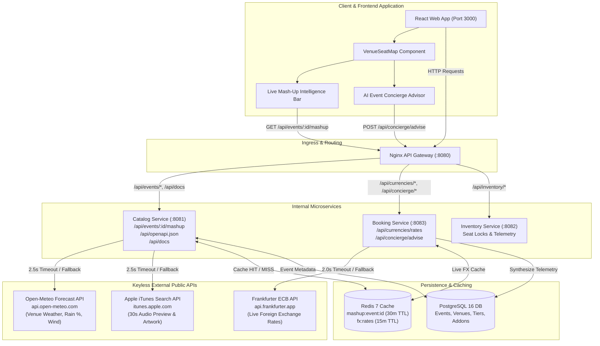

# EnIA Prompting, Skills & Subagent Orchestration Diary

> **Project:** Enterprise Event Ticket Booking System  
> **Course / Program:** Engineering Next-Gen Intelligent Autonomous Agents (EnIA)  
> **Paradigm:** *From Coding to Composing* — Autonomous Multi-Engine Agent Orchestration  
> **Date:** October 2026  

---

## 1. Executive Summary: The "From Coding to Composing" Paradigm

In traditional software engineering, developers spent their hours manually writing boilerplate code, writing CRUD routines, hand-tuning CSS syntax, and debugging mechanical type errors. In the **EnIA paradigm**, the role of the software architect transitions **from coding to composing**:

1. **System Composition over Implementation**: Rather than writing low-level routines by hand, the engineer designs formal contracts, architecture boundaries, and behavioral constraints. Systems are synthesized by composing specialized autonomous subagents, reusable skill playbooks, and verified external public APIs.
2. **Deterministic Fallbacks & Resilience First**: Production microservices must maintain uptime under adverse network partitions. Composing external keyless public APIs (e.g., Open-Meteo Weather, Apple iTunes Search, Frankfurter ECB Live FX) requires deterministic fallbacks (`fallbackUsed: true`, 2.5s circuit-breaker deadlines, Redis caching) to guarantee graceful degradation.
3. **Rigorous RED-GREEN TDD & Verification Proofs**: Autonomy does not imply guesswork. Every feature, bugfix, or contract change is strictly governed by failing unit/integration tests before code implementation, verified by silent CLI wrappers and multi-engine test runners.

---

## 2. Evolution: From Ad-Hoc Prompts to Domain & Workflow Skills

Over the course of 33 evolutionary milestones, our engineering interaction models evolved through three distinct generational phases:

```
┌───────────────────────────┐      ┌───────────────────────────┐      ┌───────────────────────────┐
│  Phase 1: Ad-Hoc Prompts  │ ───► │   Phase 2: Domain Skills  │ ───► │ Phase 3: Autonomous Mesh  │
│  "Write a Go service..."  │      │   .agent/skills/<name>    │      │ Lead-Worker Hierarchy     │
│  - Fragile turn-by-turn   │      │   - Codified workflows    │      │ - 4-Tier Engine Routing   │
│  - Token-heavy recon      │      │   - Stack-specific laws   │      │ - Dynamic API Mashup Hub  │
└───────────────────────────┘      └───────────────────────────┘      └───────────────────────────┘
```

### The Registered Skill Matrix

Instead of re-explaining patterns across conversational turns, domain and workflow expertise was extracted into persistent skills:

| Registered Skill | Scope | Core Responsibility |
|:---|:---|:---|
| `karpathy-guidelines` | Global Behavioral | Surgical edits, zero speculative abstractions, explicit assumptions, verifiable success criteria. |
| `auto-ship` | Delivery Orchestration | Direct reconnaissance, Architecture Cache, Tech Lead Planning, 4-tier worker dispatch, DoD sign-off. |
| `executing-plans` | Implementation | Inline execution of implementation plans under RED-GREEN TDD with explicit deviation rulings. |
| `go-concurrency-patterns` | Backend Core | Goroutine worker pools, channel fan-out/fan-in, sync primitives, `context.WithTimeout` deadlocks prevention. |
| `saga-orchestration` | Distributed Transactions | Compensating transactions, multi-step booking workflows, inventory lock leases, and DLQ handling. |
| `sql-optimization-patterns` | Database Performance | Schema indexing, row-level locks (`SELECT ... FOR UPDATE`), transaction isolation levels, EXPLAIN analysis. |
| `react-state-management` | Frontend State | Optimistic UI updates, server cache synchronization, reactive seat selection state. |
| `e2e-testing-patterns` | System Verification | Black-box gateway HTTP testing, synthetic concurrency load testing, boundary conflict assertion. |
| `ui-ux-pro-max` | Experience Design | Design tokens, WCAG 2.1 AA contrast compliance, dark-mode cinema canvas, responsive accessibility. |
| `archify` | Architecture Modeling | Visualizing data pipelines, state machines, sequence diagrams, and OpenAPI contract boundaries. |

---

## 3. Multi-Engine Lead & 4-Tier Worker Subagent Hierarchy

To prevent burning expensive cognitive model tokens (e.g., Argon / Pro) on mechanical coding or repetitive testing, we instituted the **Asymmetric Lead-Worker Architecture**:

### The 4-Tier Worker Engine Routing

```
                         ┌─────────────────────────────┐
                         │   Lead Architect (Tier 0)   │
                         │   Opus 5.5 / Argon Low      │
                         │  - 1-Turn Plan Design       │
                         │  - Contract Gatekeeping     │
                         │  - DoD Final Diff Sign-Off  │
                         └──────────────┬──────────────┘
                                        │
             ┌──────────────────────────┼──────────────────────────┐
             ▼                          ▼                          ▼
   ┌───────────────────┐      ┌───────────────────┐      ┌───────────────────┐
   │ Tier 1: In-Session│      │ Tier 2: OpenCode  │      │ Tier 3: River AI  │
   │ Flash Subagent    │      │ Zero-Quota Free   │      │ DeepSeek-V4-Flash │
   │ (Subagent tool)   │      │ (Headless CLI)    │      │ (High-throughput) │
   └───────────────────┘      └───────────────────┘      └───────────────────┘
                                        │
                                        ▼ Rate-Limit Fallback
                              ┌───────────────────┐
                              │ Tier 4: Copilot   │
                              │ Claude Sonnet 4.5 │
                              │ (Safety Net)      │
                              └───────────────────┘
```

1. **Lead Brain (Tier 0)**: Executes high-level architecture design, empirical plan breakdown (`docs/superpowers/plans/`), escalation triage, and 1-turn branch diff sign-offs. Strictly avoids mechanical multi-turn editing.
2. **Worker Engines (Tiers 1–4)**: Execute plan tasks in strict RED-GREEN order, write unit tests, run Docker commands, and verify test assertions.
3. **Escalation Protocol**: If any worker fails a test twice on the same error: **STOP**. Escalate back to the Lead with stack traces and reproduction steps for root-cause triage under `systematic-debugging`.

### The 4 Token Economy Laws

1. **Law 1: Universal Silent-On-Success Test Wrapper**: Never dump massive terminal outputs into agent context. Redirect stdout/stderr to `/tmp/agy-cmd.log` with `CI=true GIT_TERMINAL_PROMPT=0 < /dev/null`, printing only `✅ PASS` or the filtered error tail (`grep -iE "(fail|error)" | tail -n 35`).
2. **Law 2: Stack-Specific Quiet Flags**: Go (`go test -timeout 30s ./...`), Node/Vitest (`npx --no-install vitest run`), TypeScript (`npx --no-install -p typescript tsc --noEmit`).
3. **Law 3: Signature-First Inspection**: Read `docs/ARCHITECTURE.md`, `openapi.yaml`, and package function signatures (`go doc`, `grep -nE`) before reading large source files. Saves ~80% of reconnaissance tokens.
4. **Law 4: Post-Test Silent Formatter Gate**: Run `gofmt -s -w .` and `prettier` silently after tests pass to avoid wasting LLM turns on whitespace or imports.

---

## 4. Chronological Prompting, Composition & Architectural Rulings Log (M1–M33)

| Milestone | Target Domain | Prompting Strategy & Architectural Ruling | Composed Subsystems |
|:---|:---|:---|:---|
| **M1** | Database Schema | Declarative schema design with foreign key cascades and seed integrity. | PostgreSQL 16, SQL DDL |
| **M2** | Event Catalog | Direct REST contract with query parameter filtering and memory caching. | Go net/http, PostgreSQL |
| **M3** | Seat Inventory | Atomic hold with TTL expiration and row-level mutex locking. | Go sync.Mutex, Redis atomic keys |
| **M4** | Booking Saga | Distributed 2-phase checkout with compensating release on payment failure. | Go Saga Orchestrator, PostgreSQL |
| **M5** | API Gateway | Single Nginx reverse proxy with CORS headers, rate limiting, and correlation IDs. | Nginx 1.25, Distributed Tracing |
| **M6** | Interactive Frontend | React + Vite single-page application with curved cinema SVG canvas. | React 18, TypeScript, Tailwind |
| **M7** | Docker Orchestration | Multi-stage Dockerfiles with healthcheck-dependent startup hierarchy. | Docker Compose, Alpine |
| **M8** | E2E Verification | Automated Python test harness validating full end-to-end checkout flow. | Python 3, Pytest, Requests |
| **M26** | Currency & Invoicing | Frankfurter ECB live FX integration, regional VAT matrix, PDF invoice engine. | Go UniPDF/FPDF, Frankfurter API |
| **M27** | Waitlist & Transfer | FIFO waitlist queue with automated promotion and cryptographic ticket transfer. | Redis Sorted Sets, HMAC Tokens |
| **M28** | Notification & Calendar | Real-time in-app notification center + RFC 5545 iCalendar (`.ics`) generation. | WebSocket / Polling, iCal Spec |
| **M29** | VIP Add-ons Upsell | Concessions & merchandise bundling with atomic inventory reservation. | PostgreSQL, React Modal |
| **M30** | Reviews & Ratings | Verified buyer reviews with Bayesian average rating scorecards. | PostgreSQL, Full-Text Search |
| **M31** | Search & Floorplan | Geolocation radius search, faceted category tallies, and venue floorplan matrices. | Go Faceting, React Canvas |
| **M32** | Async Notifications | RabbitMQ topic consumers with Dead-Letter-Exchange (DLX/DLQ) fault isolation. | RabbitMQ 3, Go Worker Daemon |
| **M33** | Mash-Up & Concierge | Open-Meteo Weather + iTunes Audio Preview + OpenAPI 3.0 + AI Concierge Advisor. | Open-Meteo, iTunes, OpenAPI 3.0, AI |

---

## 5. Runtime External API Mash-Up & AI Concierge Architecture



---

## 6. Contract Validation & Fallback Verification

To guarantee zero service degradation:
1. **Public APIs Require Zero API Keys**: Open-Meteo, iTunes Search, and Frankfurter ECB are keyless.
2. **Circuit Breakers with Deterministic Fallbacks**: Every outbound HTTP call is bounded by strict context timeouts (`2.5s` for Catalog mashup, `2.0s` for ECB FX). When external APIs time out or return HTTP 500, services respond with HTTP 200, `fallbackUsed: true`, and complete fallback payloads.
3. **Structured RFC 7807 Error Contracts**: Malformed payloads or missing required fields (such as empty `eventId` on `POST /api/concierge/advise`) fail fast with HTTP 400 Bad Request and structured error details (`{"code":"VALIDATION_ERROR","error":"eventId is required","fallbackUsed":false}`).
4. **OpenAPI 3.0 Single Source of Truth**: The complete API landscape is documented in `docs/openapi.yaml`, served live at `GET /api/openapi.json`, and interactively browsable at `GET /api/docs`.
